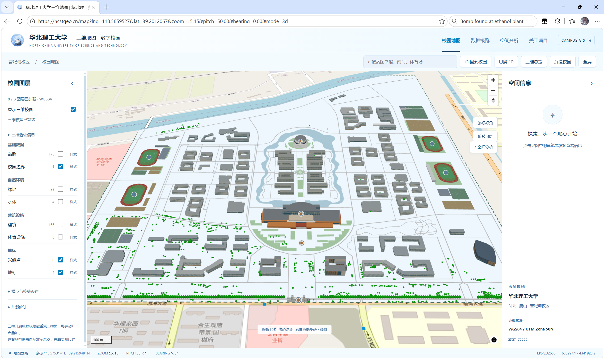
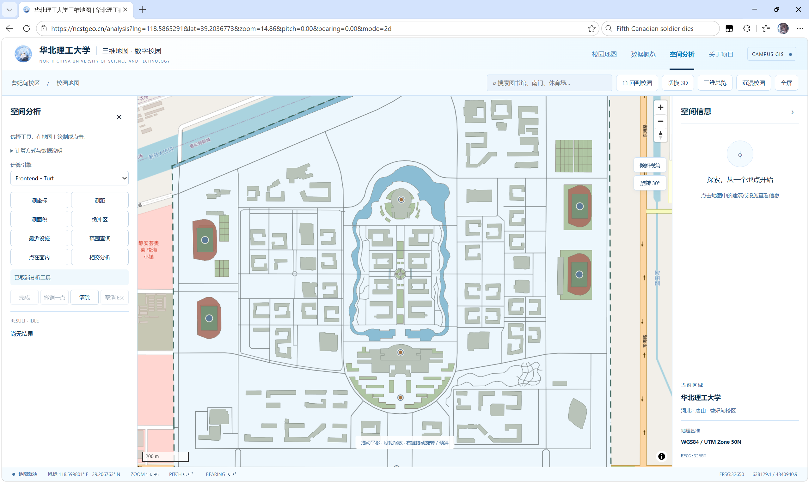
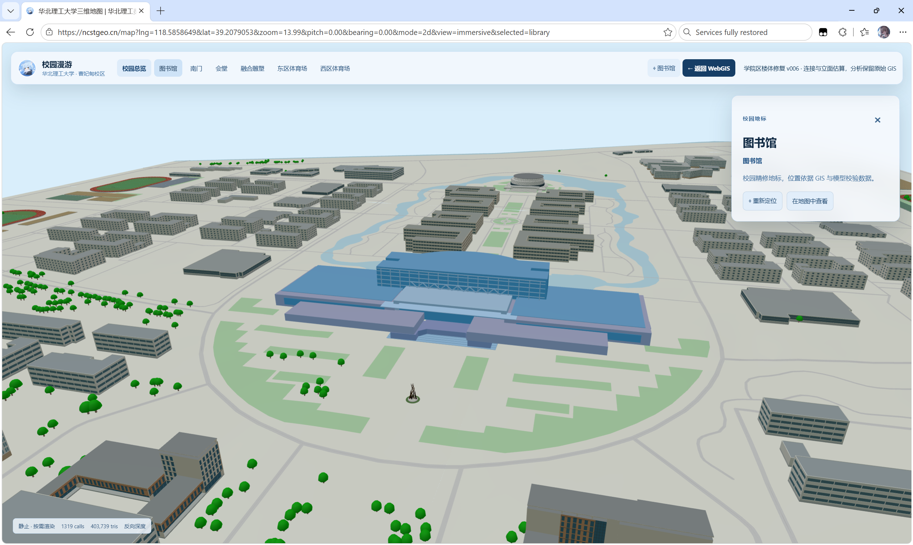

# 华北理工大学数字校园 WebGIS

一个以曹妃甸校区为对象的独立 GIS 工程演示：从校园总图配准、地标低模重建，到二维地图、三维校园、空间分析和生产部署。不是学校官方网站。

站点名称：**华北理工大学三维地图 / 华北理工数字校园**。

## 公开源码范围

本仓库发布前后端完整源码、测试、建模生成/导出/校验脚本、诊断页面和部署工具。代码内经审核的楼体尺寸、描绘坐标与模型绑定参数清单一并公开。**不包含校园 GLB/Blender 模型、原始 GeoJSON、源影像、数据库内容、生产凭据、部署发布包或运行记录。** 下方三张用户提供的界面预览图是明确许可的展示素材例外，不是原始地理数据。

因此，克隆源码后可安装依赖并构建前端程序；要实际加载完整校园、运行数据导入与数据依赖测试，仍需自行提供有授权的模型和 GIS 数据。本仓库不是开箱即用的校园数据包。参见 [数据依赖说明](SOURCE_DATA_REQUIREMENTS.md)。网站插图标识按项目用途使用，不据此授予第三方素材的再许可。

[在线地图](https://ncstgeo.cn/map) · [统计概览](https://ncstgeo.cn/dashboard) · [空间分析](https://ncstgeo.cn/analysis) · [项目介绍](https://ncstgeo.cn/about)

## 界面预览

### 三维校园地图



### 空间分析



### 沉浸校园



预览来自用户提供的线上页面截图；建筑轮廓、立面与高度包含展示级近似，不代表全校实测成果。

## 三分钟演示

1. 在地图搜索图书馆，查看属性并切换三维。
2. 进入沉浸校园，跳转图书馆、南门、会堂和体育场。
3. 在空间分析里为图书馆生成缓冲区，对比 Turf 与 PostGIS。
4. 在统计概览点击建筑或道路图表，地图仅显示该图层与校园边界；点击“显示全部图层”恢复。

## 工程架构

```text
HTTPS → Nginx → Vue 3 / TypeScript / MapLibre / Three.js / Turf
              └ /api/v1 → Spring Boot / Java 21 → PostgreSQL / PostGIS
```

数据库和后端仅通过内部网络连接。前端保留 static / api 双数据源；静态模式可独立演示，不会在 API 出错时偷偷换源。

校园权威几何使用 EPSG:32650；浏览器 GeoJSON 使用 EPSG:4326，校园局部原点与 GLB 地理配准由共享坐标服务管理。

## 项目目录

- `web/`：前端、测试、GIS 数据处理与建模参数导出脚本（历史验收材料不随仓库分发）。
- `server/`：REST API、PostGIS 查询、Flyway migration。
- `infra/`：生产 Docker Compose、Nginx、HTTPS、备份与健康检查。
- `scripts/`：Blender 建模、GIS 定位、模型集成、导出和校验工具。
- `diagnostics/`：早期模型浏览与回归测试页面源码，不含测试报告和资产。
- `reference/`：保留的模型评审页面源码；影像、定位记录及模型资料不随仓库分发。
- `docs/previews/`：经许可的三张界面预览图。
- `output/`、`blender/` 等运行时数据目录需要自行准备，稳定模型禁止覆盖。

前端启动和验证见 [web/README.md](web/README.md)，后端见 [server/README.md](server/README.md)，生产部署见 `infra/` 内说明。不要提交 `.env`、私钥或服务凭据。

## 统计口径与准确性

在线建筑、道路、绿地、水体和体育场统计来自 PostGIS；校园边界面积由版本化静态边界转换至 UTM 后计算。静态模式在浏览器用同一坐标基准计算。

体育场按四处统计，跑道与内场共八个 GIS 面。建筑数是 GIS 要素数，不是楼宇登记数。面积累计未做重叠消除；绿地/水体图只比较已收录的两类面，不是全校园土地利用构成。

总图、影像和公开资料推导的数据属于展示级精度，不能替代测绘成果。原始来源署名见 [LICENSE.txt](LICENSE.txt)，公网可访问 [来源说明](https://ncstgeo.cn/data-attribution.txt)。

正式模型：`campus_refined_v005.glb`，SHA-256 `7BD41728D1F2B1F5C631D853ABCB824841FC4F8E539B91CD08A0218C24FD3B65`。
